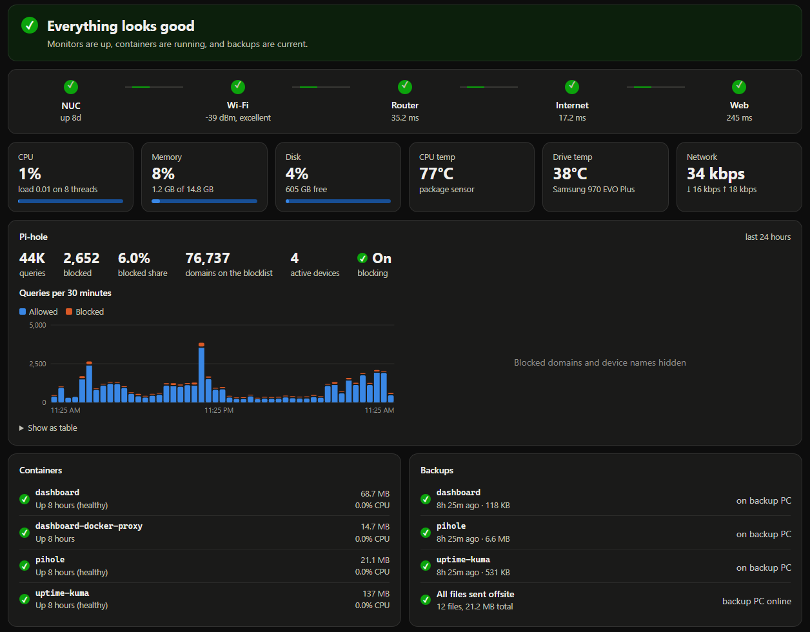
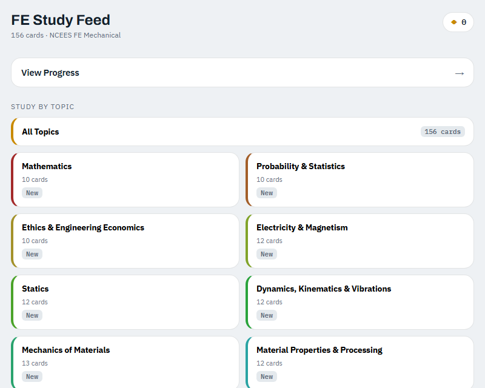

# Hi, I'm Carson

I'm a mechanical engineering student at Cal Baptist, graduating in April 2027. This is where I keep the software I've made. I'm not a programmer by training, so I build these with AI, usually because something was taking me too long.

My mechanical engineering work is on [my website](https://cwoodard3950-cloud.github.io/). You can also find me on [LinkedIn](https://www.linkedin.com/in/carsonwoodard) or [email me](mailto:carsonwoodard3950@gmail.com).

## Lab Grader

I'm a TA for thermo and grade about 20 group lab reports a week. Each one was taking me around 15 minutes, so I made a desktop app to help. It's down to about 3 minutes a report, and I still check every score myself.

You give it the lab's instructions and rubric, then drop in the submissions from Canvas. It matches each file to a lab group, and the Claude API reads each report and suggests a score for every rubric item. Next to each score it shows its reasoning and highlights the part of the report it's talking about, and it marks the ones it's unsure about. I go through them one at a time with the keyboard, approving or changing each score.

Before anything is sent to the API, it removes the cover page and deletes student names, emails and ID numbers from the file. It never touches Canvas directly. When I'm done, it makes a grade file that I upload myself.

A few other things I'm happy with:

- Resubmissions get compared against the group's first attempt, so students only lose points for problems in the original comments or for things that got worse.
- Grading costs about 5–10¢ a report with the default model.
- The rubric is editable, so it isn't tied to thermo.
- It updates itself when I release a new version.

The source is private for now, but the [installer is here](https://github.com/cwoodard3950-cloud/lab-grader-releases/releases/latest).

## Home server

I have an Intel NUC running Ubuntu that I'm using to learn DevOps. I was new to the terminal when I started.

The dashboard on my server. I hid the blocked domains and renamed my devices for this screenshot.

Here's what's running on it:

- **Pi-hole** for DNS filtering, in its own Docker Compose stack. All the stacks live in a Git repo, with the passwords kept out of it.
- **Uptime Kuma** checks the internet connection, the server and Pi-hole, and messages me on Discord when something goes down.
- **Backups** run every night from cron. A script stops each stack, archives it, starts it again and keeps 14 days of copies. A second script sends new archives to another PC over Tailscale and skips anything it's already sent.
- **A status dashboard** that AI built for me. It shows live CPU, memory, temperatures and network traffic, plus blocked DNS queries, containers, whether the backups made it across, and up to 30 days of history. The container runs as non-root with a read-only filesystem.

I log in over SSH with keys only, and use Tailscale to reach it from anywhere.

It's taught me some things I wouldn't have thought about. The nightly backup stops Pi-hole for a few seconds, so Kuma logs a tiny outage around 3 AM every night. I also get spikes in router response time even with a strong Wi-Fi signal, and I haven't figured out why yet.

Next on my list:

- Practice restoring a backup, since I haven't actually tried one yet
- Get an alert when a backup doesn't run
- Plug in Ethernet and compare it to Wi-Fi
- Use names and HTTPS instead of port numbers

## FE Study Feed

I wanted to study for the FE in the time I'd normally spend scrolling on my phone, so this is a swipeable feed of quiz questions, flashcards and formulas. Topics you keep missing come up more often. [Try it here](https://cwoodard3950-cloud.github.io/fe-study-feed/) or [see the repo](https://github.com/cwoodard3950-cloud/fe-study-feed).

