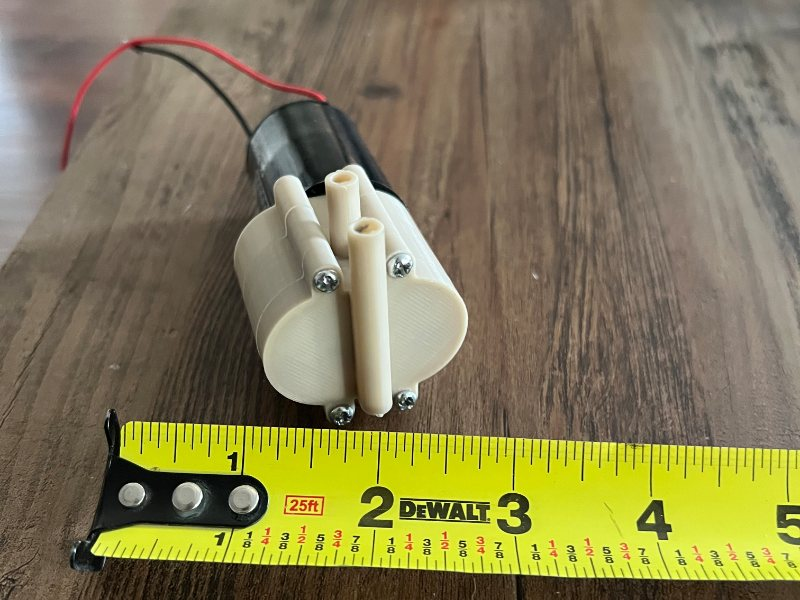

# Hi, I'm Carson

I'm a mechanical engineering student at Cal Baptist, graduating in April 2027 with a minor in Industrial Systems Engineering. Right now I'm an intern on the manufacturing sustaining team at pSemi in San Diego, and at school I tutor statics and TA for thermo. I'm looking for a full-time job in manufacturing, quality or design after I graduate.

I'm a mechanical engineer, not a programmer. The code on here was written with AI, usually because something at work or school was taking me too long.

[Portfolio](https://cwoodard3950-cloud.github.io/) · [LinkedIn](https://www.linkedin.com/in/carsonwoodard) · [Email](mailto:carsonwoodard3950@gmail.com)

## Lab Grader

I grade about 20 thermo lab reports a week, and each one was taking me around 15 minutes. So I made a desktop app that reads a report and suggests a score for each rubric item, along with its reasoning and the part of the report it's looking at. I still check every score, but it's down to about 3 minutes a report.

It takes student names, emails and ID numbers out before anything goes to the Claude API. When I'm done, it gives me a file to upload to Canvas. The source is private for now, but the [installer is here](https://github.com/cwoodard3950-cloud/lab-grader-releases/releases/latest).

## FE Study Feed

I wanted to study for the FE in the time I'd normally spend scrolling on my phone, so this is a swipeable feed of quiz questions, flashcards and formulas. Topics you keep missing come up more often. [Try it here](https://cwoodard3950-cloud.github.io/fe-study-feed/) or [see the repo](https://github.com/cwoodard3950-cloud/fe-study-feed).

## Home server

I have an Intel NUC running Ubuntu that I'm using to learn DevOps. It runs Pi-hole and Uptime Kuma in Docker, messages me on Discord when something goes down, and backs itself up every night to another PC over Tailscale. AI built the status dashboard for me. Next I need to practice actually restoring a backup.

## Engineering work

Most of what I do isn't code, so it doesn't live on GitHub. The write-ups are on [my portfolio](https://cwoodard3950-cloud.github.io/).

- **[HAPS capstone](https://cwoodard3950-cloud.github.io/#haps):** an 8-person senior project to detect and track fixed-wing drones and launch an interceptor, for NSWC Corona. I started on the airframe and moved over to electrical, which I'm learning from scratch.
- **[Solderability DOE](https://cwoodard3950-cloud.github.io/#doe) (pSemi):** a JMP experiment on paste-print settings, to make solderability testing on 75 µm bumps more repeatable.
- **[Reflow root cause](https://cwoodard3950-cloud.github.io/#reflow) (pSemi):** tracked down a wetting failure by profiling the oven with a KIC, then adjusted the setpoints to get back in spec.
- **[SiP model](https://cwoodard3950-cloud.github.io/#sip) (pSemi):** a SolidWorks model of a flip-chip package, built from GDS files, for simulation in Ansys.
- **[Gear pump](https://cwoodard3950-cloud.github.io/#pump):** my team of 4 took a 12 V gear pump, rebuilt it in CAD and printed a working one in PLA. It only moved 0.50 L/min against the original's 1.63.

## Outside of work

I surf, run, cycle and swim, and I spend a lot of time working on my '02 Ram 2500 Cummins and my dirt bikes. I also shoot film and make things in the shop. One of those was a [ring made from reclaimed 18k gold](https://cwoodard3950-cloud.github.io/#ring).
