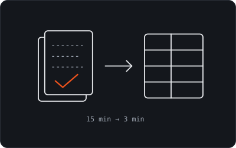
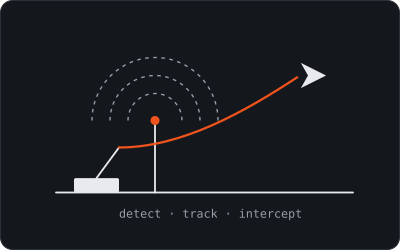
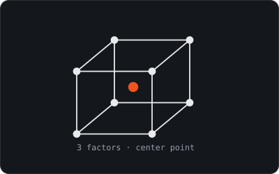
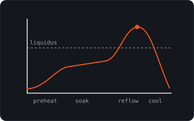
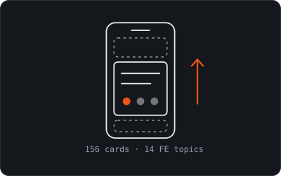
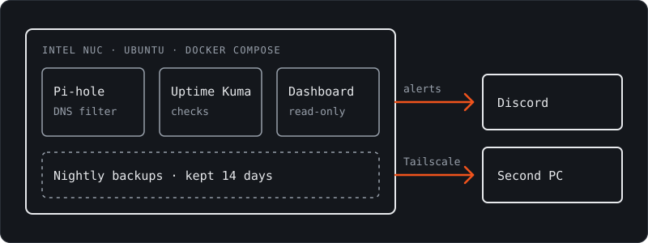

  
  
  

I like engineering I can put my hands on. I'm a mechanical engineering student at California Baptist University, graduating April 2027 with a minor in Industrial Systems Engineering, and I'm working on a semiconductor manufacturing line at pSemi, a Murata company.

Most of my projects mix CAD and physical parts with software that removes the repetitive work. I'm an engineer first, so I build that software with AI.

## Featured: [Lab Grader](https://github.com/cwoodard3950-cloud/lab-grader-releases)

**A desktop app that cut my review time from about 15 minutes to 3 per lab report, with a person still checking every score.** I grade about 20 Thermodynamics group lab reports a week as a TA, and I built this with AI to handle them.

- **Suggests, never decides:** the Claude API proposes a score for each rubric criterion and shows its reasoning and the spot in the report behind it. I approve or change every one.
- **Protects students:** it removes cover pages and redacts names, emails and ID numbers before a report is sent to the AI. The text is deleted, not just covered.
- **Fits the real workflow:** it imports Canvas rosters, grades against each lab's own instructions, compares resubmissions with the first attempt, and exports files for Canvas import.
- **Ships like a product:** a Windows installer with automatic updates, at roughly 5–10¢ per report. [Download the latest release](https://github.com/cwoodard3950-cloud/lab-grader-releases/releases/latest).

`Claude API` `Electron` `Canvas`

## Selected projects

<table>
  <tr>
    <td width="50%" valign="top">
      
      <h3>HAPS Counter UAV System</h3>
      Senior capstone · team of 8 · in progress
      
A ground-based system to detect and track fixed-wing drones, then launch an interceptor, for NSWC Corona. I started on the airframe and moved to electrical, where I built a bench setup to validate a custom YOLO model and Raspberry Pi to flight controller communication.

      <code>YOLO</code> <code>Raspberry Pi</code> <code>MAVLink</code> <code>SolidWorks</code> <code>Ansys</code>
    </td>
    <td width="50%" valign="top">
      
      <h3>Paste-print DOE for solderability</h3>
      pSemi internship · Summer 2026
      
A designed experiment to make die-level solderability testing repeatable on 75 µm bumps, against JEDEC J-STD-002D. Three print factors, with all main effects and two-factor interactions: 16 base runs plus 3 center points.

      <code>JMP</code> <code>Paste printer</code> <code>Heller reflow</code> <code>FineTech bonder</code>
    </td>
  </tr>
  <tr>
    <td width="50%" valign="top">
      
      <h3>Reflow wetting failure root cause</h3>
      pSemi internship · Summer 2026
      
Traced a wetting failure on 75 µm-bump die. I measured the actual zone profiles with a KIC thermal profiler, then adjusted the oven setpoints to bring the process window index back within spec.

      <code>KIC profiler</code> <code>Heller reflow</code> <code>Keyence</code> <code>Root cause analysis</code>
    </td>
    <td width="50%" valign="top">
      
      <h3>FE Study Feed</h3>
      Built with AI · <a href="https://cwoodard3950-cloud.github.io/fe-study-feed/">try it</a> · <a href="https://github.com/cwoodard3950-cloud/fe-study-feed">repo</a>
      
A swipe-to-study feed for the FE Mechanical exam that fills the same phone habit as scrolling. Quizzes, flashcards, formulas and handbook drills, with weak topics coming up more often.

      <code>SwiftUI</code> <code>Web app</code> <code>FE Mechanical</code>
    </td>
  </tr>
</table>

### More

| Project | What it is |
|---|---|
| [**Miniature gear pump**](https://cwoodard3950-cloud.github.io/#pump) | Measured a purchased 12 V gear pump, rebuilt it in CAD and printed a working copy in PLA. It moved 0.50 L/min against the original's 1.63 and cost 19.9% less, but about 2.6 times as much per unit of flow. Team of 4. |
| [**SiP package 3D model**](https://cwoodard3950-cloud.github.io/#sip) | A layer-by-layer SolidWorks model of a flip-chip die and bump stack, built from GDS layout files as the input to an Ansys Mechanical thermo-mechanical simulation. |
| [**Access Storage**](https://cwoodard3950-cloud.github.io/#access) | A hand-cranked, chain-driven carousel that brings overhead garage storage within reach. Junior design, team of 6. |
| **Mochi for Windows** | A Windows port of Mochi, a pixel-critter desktop pet that walks along the taskbar and follows along with Claude Code. Its usage tracking is adapted from Eli Manning's [Ai-Usage](https://github.com/eli-manning/Ai-Usage). |
| [**Gold solitaire ring**](https://cwoodard3950-cloud.github.io/#ring) | Hand-made from reclaimed 18k gold: cast, rolled and annealed. |

## Home server

I run an Intel NUC on Ubuntu to learn DevOps by doing it, starting from being new to the terminal.

- **Services as code:** each service is its own Docker Compose stack in a Git repo, with passwords kept out of Git.
- **Monitoring:** Uptime Kuma watches the internet connection, the server and Pi-hole, and sends alerts to Discord.
- **Backups:** a nightly cron job stops each stack, archives it, restarts it and keeps 14 days of copies. A second script sends new archives to another PC over Tailscale, and it skips anything already sent.
- **Remote access:** SSH with key login only, and Tailscale to connect from anywhere.
- **Custom dashboard, built with AI:** one page for live CPU, memory, temperature and network stats, blocked DNS queries, containers, backup status and up to 30 days of history. Its container runs as non-root with a read-only filesystem and no Linux capabilities.

**Next on my list:** practice restoring a backup, get alerted when a backup doesn't run, compare Wi-Fi and Ethernet response times, and move from port numbers to names with HTTPS.

`Ubuntu` `Docker Compose` `Pi-hole` `Uptime Kuma` `Tailscale` `cron` `Bash`

## Experience

| Role | Where | When |
|---|---|---|
| **Operations Manufacturing Sustaining Intern** | pSemi, a Murata company | May 2026 – now |
| **Statics Tutor and Thermodynamics TA** | California Baptist University | Sep 2025 – now |
| **Parts Manufacturing and Assembly Assistant** | PrintSafe, Inc. | Jun 2024 – Aug 2025 |
| **Service Room Manager** | Discount Tire | Jul 2022 – Jul 2024 |

## Toolbox

| Area | Tools and methods |
|---|---|
| **CAD and analysis** | `SolidWorks` `AutoCAD` `Ansys` `GD&T` `FEA` `VBA macros` |
| **Process** | `DOE in JMP` `Solder paste printing` `Reflow profiling` `Flip-chip bonding` `Keyence inspection` |
| **Quality** | `SPC` `FMEA` `8D` `Root cause analysis` `Process capability` `Lean` `J-STD-002D` |
| **Software** | `MATLAB` `RStudio` `Excel` `Claude API` `Modelio (MBSE)` `Linux` |
| **Shop** | `Machining` `MIG welding` `Metal casting` `FDM printing` `FARO arm` |

## Away from the desk

I'm usually outside: surfing, running, cycling or swimming. I also work on my '02 Ram 2500 Cummins and my dirt bikes, shoot film, and make things in the shop.

**Open to full-time roles in manufacturing, quality and design from 2027.** [Let's talk.](mailto:carsonwoodard3950@gmail.com)
